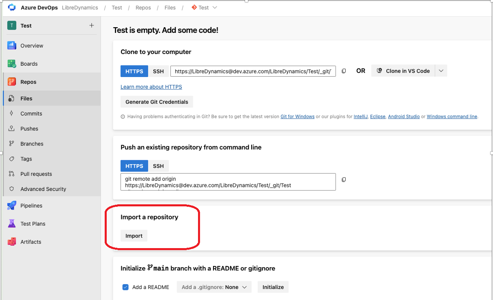
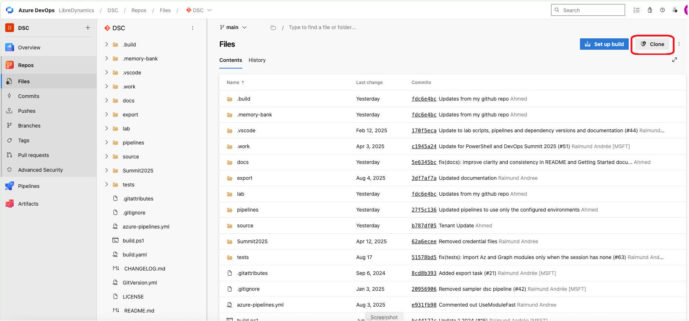
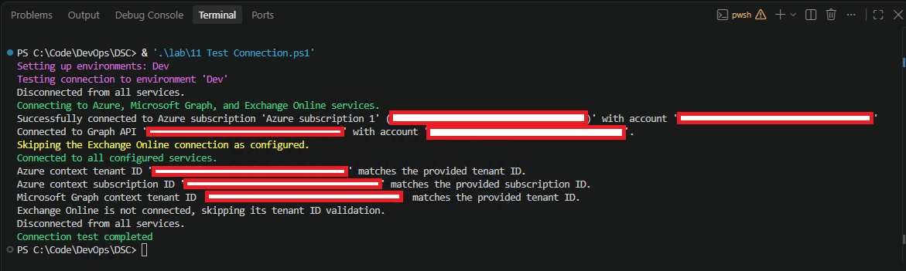
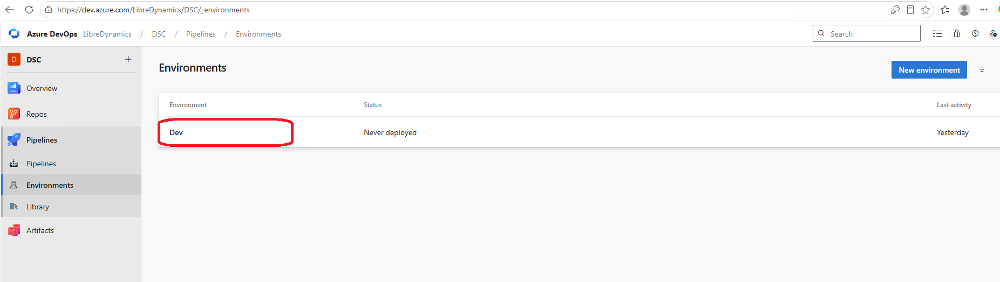
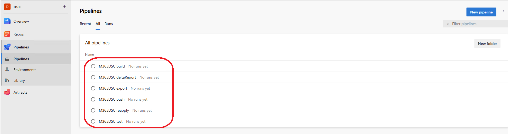

# The quick guide to the Microsoft365DscWorkshop

- [The quick guide to the Microsoft365DscWorkshop](#the-quick-guide-to-the-microsoft365dscworkshop)
  - [1. Getting started](#1-getting-started)
    - [1.0.1. Prerequisite](#101-prerequisite)
  - [1.1. Import the Project into Azure DevOps](#11-import-the-project-into-azure-devops)
  - [1.2. Cloning the Project](#12-cloning-the-project)
  - [1.3. Run the Lab Setup Scripts](#13-run-the-lab-setup-scripts)
    - [1.3.1. `00 Prep.ps1`](#131-00-prepps1)
    - [1.3.2. Test the Build and Download Dependencies](#132-test-the-build-and-download-dependencies)
  - [1.4. Set your Azure Tenant Details](#14-set-your-azure-tenant-details)
    - [1.4.1. Initialize the session (Init task)](#141-initialize-the-session-init-task)
    - [1.4.2. `10 Setup App Registrations.ps1`](#142-10-setup-app-registrationsps1)
    - [1.4.3. `11 Test Connection.ps1`](#143-11-test-connectionps1)
    - [1.4.4. `20 Configure AzDo Project.ps1`](#144-20-configure-azdo-projectps1)
    - [1.4.5. `30 Create Agent VMs.ps1`](#145-30-create-agent-vmsps1)
    - [1.4.6. `31 Agent Setup.ps1`](#146-31-agent-setupps1)
  - [1.5. Running the Pipeline](#15-running-the-pipeline)
  - [All done](#all-done)

## 1. Getting started

> :information_source: If you only want to export your tenant configuration with [Microsoft365DSC](https://microsoft365dsc.com/), see the [export guide](../export/readme.md).

### 1.0.1. Prerequisite

> [!WARNING]
> You must be a local administrator on the machine where you run the setup scripts.

## 1.1. Import the Project into Azure DevOps

To use this project, you need to change some files, so first create a writable copy. Import this repository into a project hosted on Azure DevOps.

1. Create a new project in your Azure DevOps organization.
2. In the new project, open **Repos**.
3. Select **Import** to add the repository.
4. Enter `https://github.com/dsccommunity/Microsoft365DscWorkshop.git` as the clone URL and select **Import**. It may take a few seconds to copy the content.



This guide assumes that you have created an Azure DevOps project and imported this repository. Alternatively, you can fork it on GitHub, but some scripts will not work and you will need to perform the related tasks manually.

> **Warning:** You can run the project on any code management / automation platform of your choice, but for the standard setup to work, it is expected
> to host it on Azure DevOps.

## 1.2. Cloning the Project

Clone the project using the Source Control view in Visual Studio Code or the `git` command. Replace the placeholders below with your Azure DevOps repository URL and the local path where you want to clone it.

> :information_source: Select **Clone** in your Azure DevOps repository to get its HTTPS URL.

```powershell
git clone "https://dev.azure.com/ORGANIZATION/PROJECT/_git/REPOSITORY" "C:\path\to\local\repository"
```



## 1.3. Run the Lab Setup Scripts

After cloning the project to your development machine, open it in Visual Studio Code.

### 1.3.1. `00 Prep.ps1`

Run all commands in this guide from a PowerShell prompt opened at the repository root. The setup scripts are organized under [lab/AutomatedLab](../lab/AutomatedLab/) and [lab/Azure](../lab/Azure/).

Run [00 Prep.ps1](../lab/AutomatedLab/00%20Prep.ps1):

```powershell
& '.\lab\AutomatedLab\00 Prep.ps1'
```

> :information_source: Run this script from an elevated PowerShell session because it installs modules for all users.

The script performs the following steps:

- Installs the following modules to your machine:
  - [VSTeam](https://github.com/MethodsAndPractices/vsteam)
  - [Az.Accounts](https://learn.microsoft.com/powershell/azure/)
- Sets the project name in [ProjectSettings.yml](../source/Global/ProjectSettings.yml) to the name of your Azure DevOps project. You should see the change in the Source Control view; it will be committed later.

---

### 1.3.2. Test the Build and Download Dependencies

Test the build locally by running the build script from a PowerShell prompt in the repository root:

```powershell
.\build.ps1 -UseModuleFast -ResolveDependency
```

> :information_source: [ModuleFast](https://github.com/JustinGrote/ModuleFast) may not download all required modules on the first try. If modules are missing or you see errors, close the PowerShell session and run the command again.

If ModuleFast repeatedly fails, for example with a gallery connection timeout, use PSResourceGet instead:

```powershell
.\build.ps1 -UsePSResourceGet -ResolveDependency
```

To resolve dependencies without running the build tasks, add `-Tasks noop`:

```powershell
.\build.ps1 -UsePSResourceGet -ResolveDependency -Tasks noop
```

The first build usually takes 15 to 20 minutes because it downloads the dependencies listed in [RequiredModules.psd1](../RequiredModules.psd1) and discovers the DSC resources in [Microsoft365DSC](https://microsoft365dsc.com/).

After the build finishes, verify that it created artifacts, such as MOF files in the [MOF](../output/MOF/) folder.

> :information_source: The [MOF](../output/MOF/) folder is generated by the build process and is not part of the repository. If it is missing after the build, check the console output for errors.

---

## 1.4. Set your Azure Tenant Details

This solution can configure multiple Azure tenants. Configure the tenants you want to manage in [Azure.yml](../source/Global/Azure.yml), which includes example Dev, Test, and Prod environments.

One Azure DevOps project can be used for multiple tenants. For this setup, each tenant needs its own Azure subscription to host that tenant's agent VM; the VM must be created in a subscription associated with the tenant it will manage.

- For each environment/tenant, update `AzTenantId`, `AzTenantName`, and `AzSubscriptionId`. The setup scripts you run next will populate the application IDs, secrets, and certificate thumbprints.

- Remove any environments you do not need from [Azure.yml](../source/Global/Azure.yml). For this guide, keep only the Dev environment.

- Also remove the build-agent configuration folders you do not need for this guide:
  - [Test](../source/BuildAgents/Test/)
  - [Prod](../source/BuildAgents/Prod/)

> **Warning:** Please don't forget to remove the environments you do not need.
>
> :information_source: When getting familiar with the project, it is recommended to start with one tenant. This reduces test run times and complexity.

For example, the file could look like this if you want to configure only one tenant:

```yml
Environments:
  Dev:
    AzTenantId: b246c1af-87ab-41d8-9812-83cd5ff534cb
    AzTenantName: MngEnvMCAP576786.onmicrosoft.com
    AzSubscriptionId: 9522bd96-d34f-4910-9667-0517ab5dc595
    Identities:
    - Name: M365DscSetupApplication
      ApplicationId: <AutoGeneratedLater>
      ApplicationSecret: <AutoGeneratedLater>
    - Name: M365DscLcmApplication
      ApplicationId: <AutoGeneratedLater>
      CertificateThumbprint: <AutoGeneratedLater>
    - Name: M365DscExportApplication
      ApplicationId: <AutoGeneratedLater>
      CertificateThumbprint: <AutoGeneratedLater>
```

---

### 1.4.1. Initialize the session (Init task)

> **Warning:** Start a new PowerShell session rather than reusing the old one. A module loaded during setup may prevent a newer version of an Azure PowerShell module from loading (a familiar issue known as [DLL Hell](https://en.wikipedia.org/wiki/DLL_hell)).
>
> And don't forget: Sometimes just retrying a failed task is the best and easiest solution.

After [00 Prep.ps1](../lab/AutomatedLab/00%20Prep.ps1) and [build.ps1](../build.ps1) finish, all required modules and dependencies should be available. In the new PowerShell session, run the build script again to initialize the shell:

```powershell
.\build.ps1 -Tasks init
```

---

### 1.4.2. `10 Setup App Registrations.ps1`

Run [10 Setup App Registrations.ps1](../lab/AutomatedLab/10%20Setup%20App%20Registrations.ps1). It creates the required applications in each tenant defined in [Azure.yml](../source/Global/Azure.yml), grants their permissions, and creates a persistent credential Key Vault in a dedicated resource group for each environment.

```powershell
& '.\lab\AutomatedLab\10 Setup App Registrations.ps1'
```

The setup application's secret is stored in Key Vault and synchronized to its existing protected `Azure.yml` field as the bootstrap credential. Other application secrets and the LCM/export certificate PFX files and their passwords are stored in the environment Key Vault. Review the local `Azure.yml` changes after the script completes; credential values are not printed or automatically committed.

By default, the script reuses existing credentials and stores missing ones. Use `-RotateCredentials` only when you intend to add replacement credentials and update the Key Vault values:

```powershell
& '.\lab\AutomatedLab\10 Setup App Registrations.ps1' -RotateCredentials
```

Previous client-secret credentials and Key Vault secret versions are retained. After verifying the replacements, revoke old app secrets and remove obsolete Key Vault secret versions as appropriate.

- The `M365DscSetupApplication` app performs the initial environment setup. Although an Entra ID user could be used instead, authentication requirements may prevent the process from being automated.
- The `M365DscLcmApplication` app is used by the Azure DevOps build agent(s) to put your tenant into the desired state. A service principal is also created in Exchange Online for each app.
- The `M365DscExportApplication` app is used by the export pipeline. For details, see the [export guide](../export/readme.md).

The credential resource groups and Key Vaults are intentionally separate from the VM resource groups and remain after worker cleanup.

> :information_source: To remove the app registrations if you no longer want to use the project, run [98 Cleanup App Registrations.ps1](../lab/AutomatedLab/98%20Cleanup%20App%20Registrations.ps1) from the repository root:
>
> ```powershell
> & '.\lab\AutomatedLab\98 Cleanup App Registrations.ps1'
> ```

The cleanup script removes the app registrations but intentionally leaves the credential resource groups and Key Vaults. Delete those resource groups manually only when the environment is permanently decommissioned.

Before doing any Exchange Online prep work, the script reads the `HasExchangeOnline` setting of the environment from the [Azure.yml](../source/Global/Azure.yml) file. Set it to `false` for a tenant without an Exchange Online license: such a tenant cannot create the Exchange service principals and cannot be added to the Exchange role groups, so these steps are skipped. The same setting removes the Exchange layers from the Datum hierarchy, so no `cEXO*` configuration is compiled and no Exchange component is exported for that tenant. If the setting claims Exchange Online but the tenant is not licensed for it, the script stops with an explicit error.

The `HasSharePointOnline` setting works similarly. Set it to `false` for a tenant that should not use SharePoint Online. This removes the SharePoint layers from the Datum hierarchy, so no `cSPO*` configuration is compiled or exported. If SharePoint Online is enabled but not provisioned, its admin URL (`https://<TenantName>-admin.sharepoint.com`) may not exist, and `cSPO*` resources can fail during enactment with `The current connection holds no SharePoint context`.

Application IDs and certificate thumbprints are shown in the console; credential values are not. Generated client secrets and certificate private keys are stored in Key Vault. The setup-app secret is also stored there and synchronized to its protected bootstrap field in [Azure.yml](../source/Global/Azure.yml). The script updates that file locally but does not commit or push it; review and commit the configuration changes yourself.

> **Warning:** The setup-app bootstrap secret uses the existing Datum protection password from [Datum.yml](../source/Datum.yml). This is not a secure solution for production; protect the bootstrap credential with a certificate or another secure Datum protection method.

---

### 1.4.3. `11 Test Connection.ps1`

The previous step created the applications and credential vaults. The protected setup-app credential in [Azure.yml](../source/Global/Azure.yml) bootstraps local authentication. Now test whether authentication with the configured applications works.

Run [11 Test Connection.ps1](../lab/AutomatedLab/11%20Test%20Connection.ps1):

```powershell
& '.\lab\AutomatedLab\11 Test Connection.ps1'
```

The last line of its output should be `Connection test completed`.


---

### 1.4.4. `20 Configure AzDo Project.ps1`

This script configures the Azure DevOps project and stores its settings in [ProjectSettings.yml](../source/Global/ProjectSettings.yml). It prompts for any required values that are still placeholders in the file.

```yml
OrganizationName: <OrganizationName>
PersonalAccessToken: <PersonalAccessToken>
ProjectName: <ProjectName>
AgentPoolName: <AgentPoolName>
```

Run [20 Configure AzDo Project.ps1](../lab/AutomatedLab/20%20Configure%20AzDo%20Project.ps1). It prompts for each value that is still a placeholder in [ProjectSettings.yml](../source/Global/ProjectSettings.yml). Press Enter to accept the suggested project and agent-pool names.

1. Create a personal access token (PAT) for your Azure DevOps organization with the permissions required to manage the project. Copy the PAT to the clipboard.

2. Run [20 Configure AzDo Project.ps1](../lab/AutomatedLab/20%20Configure%20AzDo%20Project.ps1) and provide the requested information.

```powershell
& '.\lab\AutomatedLab\20 Configure AzDo Project.ps1'
```

The script:

- Prompts for the Azure DevOps organization name, project name, and PAT.
- Updates [ProjectSettings.yml](../source/Global/ProjectSettings.yml) with the information you provide.
- Creates the configured agent pool (named `DSC` by default).
- Disables non-required project features.
- Creates Azure DevOps environments based on [Azure.yml](../source/Global/Azure.yml).
- Creates the `M365DSC build`, `M365DSC deltaReport`, `M365DSC export`, `M365DSC push`, `M365DSC reapply`, and `M365DSC test` pipelines.
- Synchronizes each pipeline's environment choices from the local `Azure.yml`. The matrix-discovery stage uses those committed choices and does not read `Azure.yml` from its checkout.

Inspect the Azure DevOps project. You should now see the environments, agent pool, and pipelines.




---


### 1.4.5. `30 Create Agent VMs.ps1`

The Azure script [30 Create Agent VMs.ps1](../lab/Azure/30%20Create%20Agent%20VMs.ps1) creates one VM for each configured environment in that tenant's Azure subscription. It assigns a managed identity to each VM and grants that identity the permissions Microsoft365DSC needs to manage the tenant.

The next step connects each VM to Azure DevOps as a build agent. The agents build the DSC configuration and apply it to their respective tenants.

New VMs are deployed from the editable [Bicep template](../lab/templates/buildAgent.bicep) using `New-AzResourceGroupDeployment`. Existing VMs with the expected name are adopted instead of redeployed. The script creates an isolated resource group named `<ProjectName>-<Environment>-rg` for new deployments, uses managed disks, and adds a NAT Gateway for outbound access without a public IP on the VM. The Standard NAT Gateway and its public IP incur recurring Azure charges. It does not create a storage account. The template explicitly defines the VM image and size, network, security group, NAT Gateway, and user-assigned identity.

The legacy [AutomatedLab entry point](../lab/AutomatedLab/30%20Create%20Agent%20VMs.ps1) is also supported. It uses the same `<ProjectName>-<Environment>-rg` resource-group name, VM name, and managed-identity name; its Azure-specific network and disk resources differ from the Bicep deployment. Both creation scripts adopt an existing VM with the expected name rather than creating a duplicate. The AutomatedLab setup, start, stop, and worker-removal scripts delegate to the Azure implementations, so either creation path can be managed with either set of lifecycle scripts. Existing VMs in older, non-hyphenated resource groups are adopted in place; the scripts do not move Azure resources between resource groups.

The legacy AutomatedLab script requires `Az.Accounts 5.5.3`, installed by [00 Prep.ps1](../lab/AutomatedLab/00%20Prep.ps1), because AutomatedLab's Azure storage module requires at least 5.5.2. Run it from an elevated, fresh PowerShell process; AutomatedLab must read its local assets under `C:\ProgramData\AutomatedLab`, and PowerShell cannot replace an already-loaded Az version in a running process.

Edit the template to customize resources, or edit the corresponding parameters in `lab/Azure/30 Create Agent VMs.ps1`. The relevant settings in `ProjectSettings.yml` are:

```yml
BuildAgents:
  UserName: worker
  Password: <Password>
```

For a new deployment, install the Bicep CLI once if it is not already available:

```powershell
winget install --exact --id Microsoft.Bicep --source winget --accept-source-agreements --accept-package-agreements
```

Run [30 Create Agent VMs.ps1](../lab/Azure/30%20Create%20Agent%20VMs.ps1):

```powershell
& '.\lab\Azure\30 Create Agent VMs.ps1'
```

You will be prompted to choose a password for the build-agent VMs. You can use the default password shown in the prompt or enter a different one.

> **Warning:** Please make sure the password meets the Windows standard complexity.

---

### 1.4.6. `31 Agent Setup.ps1`

The script [31 Agent Setup.ps1](../lab/Azure/31%20Agent%20Setup.ps1) uses Azure VM Run Command to configure each worker VM and installs:

- PowerShell 7
- Git
- Visual Studio Code
- Azure DevOps Build Agent
- The latest PowerShellGet module and NuGet package provider

The script grants the VM's user-assigned managed identity read-only access to the environment Key Vault. The VM retrieves and imports the LCM and export certificates directly from Key Vault; PFX data and passwords are not sent as Run Command parameters.

Run the script:

```powershell
& '.\lab\Azure\31 Agent Setup.ps1'
```

The script then connects each agent to the specified Azure DevOps organization and adds it to the configured agent pool. It uses the certificate thumbprints configured in [Azure.yml](../source/Global/Azure.yml), and requires the matching private-key certificates to be present in Key Vault.

The script updates the local Azure configuration with the installed certificate thumbprints. If Git ignores `source/Global/Azure.yml`, it skips committing and pushing that file; synchronize it only through your approved configuration process.

VM start, stop, and cleanup scripts use Az PowerShell cmdlets directly. Cleanup removes a whole resource group only when its Bicep ownership tags match the project and environment and every resource in it has the same tags; otherwise it removes only the named VM and its attached disks and network interfaces.

The creation script also creates a managed-disk snapshot for each attached disk, named with the VM and `AfterInstall`. These are disk snapshots, not guest-quiesced VM restore points.

The agent setup installs the Microsoft365DSC version pinned in [RequiredModules.psd1](../RequiredModules.psd1). Pipeline initialization also removes other installed Microsoft365DSC versions before copying the pinned dependencies, so exports use the same version as the repository.

Check the configured Azure DevOps agent pool to confirm that the new agents appear. Each agent should have a `BuildEnvironment` capability set to its corresponding environment.

---

## 1.5. Running the Pipeline

The [20 Configure AzDo Project.ps1](../lab/AutomatedLab/20%20Configure%20AzDo%20Project.ps1) script creates these six runnable pipelines:

- `M365DSC build`
- `M365DSC deltaReport`
- `M365DSC export`
- `M365DSC push`
- `M365DSC reapply`
- `M365DSC test`

The [pipelines folder](../pipelines/) also contains YAML templates used by these pipelines. Template files such as `buildTemplate.yml` and `testDscTemplate.yml` are building blocks, not additional pipelines to run directly.

The `M365DSC test` pipeline builds and applies the configuration for the selected
environment(s) before validating deployment. It changes tenant configuration;
run it only for environments where you intend to apply the current DSC definition.

### `M365DSC deltaReport`

The [delta-report pipeline](../pipelines/deltaReport.yml) downloads the exported
tenant configurations from the `M365DSC export` pipeline, merges each tenant's
resource configurations, compares the selected source tenant with every other
exported tenant, and publishes the resulting HTML reports as the `DeltaReport`
pipeline artifact.

The **Source tenant of the delta report** parameter defaults to the configured
Dev tenant, `MngEnvMCAP289781.onmicrosoft.com`. The value must exactly match a
tenant folder name in the export, and the export must contain that source tenant
and at least one destination tenant. Change the parameter when using a different
source tenant or after updating the Dev tenant in `source/Global/Azure.yml`.

When **Replace tenant identifiers with environment names** is enabled, the
report's HTML content and filenames replace configured tenant domains and
tenant GUIDs with their environment keys from `source/Global/Azure.yml` (for
example, `Dev` and `Test`). The pipeline fails rather than publishing a report
if an exported tenant cannot be matched to that configuration. This option is
disabled by default.

To test the comparison workflow when only one real tenant is available, enable
**Create a synthetic destination tenant (test only)** when queuing the run.
This copies the selected source tenant's exported configuration files to a
temporary `delta-report-test.onmicrosoft.com` folder on the pipeline agent. It
then changes one quoted string property in the copied configuration, preferring
`DisplayName`, then `Description`, and then another non-secret literal property.
It appends `[synthetic delta test]` to that property's value. The source export
remains unchanged, and the resulting HTML report should show this intentional
configuration difference. The pipeline fails with a clear error if it cannot
find a suitable string property to change.

This option does not create a real tenant, Azure subscription, or VM agent, and
the synthetic configuration is for report testing only; do not use it to apply
configuration to a tenant. Leave the option disabled for normal runs.

The `M365DSC push` pipeline runs for changes to the `main` branch, except changes limited to `CHANGELOG.md`, and for tags that start with `v` and do not contain a hyphen. It builds the DSC artifacts, applies the configuration to the configured tenants, and validates the result.

The `M365DSC push` pipeline may have started automatically. If no run appears, start it manually from the Pipelines page in Azure DevOps, then open the run.

- Open the Pipelines page in your Azure DevOps project.
- If the run is waiting for permission to access a resource, Azure DevOps displays a message such as: `This pipeline needs permission to access a resource before this run can continue to Build of environment Dev`.

Select **View** next to the permission message, then select **Permit** in the **Waiting for review** dialog.

After a few seconds, a build agent should pick up the job.

> To see what the build agent is doing, open the `Build of environment Dev` stage. In [Test the Build and Download Dependencies](#132-test-the-build-and-download-dependencies), you ran the build script locally and created artifacts such as RSOP and MOF files. The agent performs the same process, so the output should look familiar.

After the `Build of environment Dev` stage finishes, open the `Deployment in Dev` stage. The first time the pipeline deploys to the Dev environment, Azure DevOps may ask you to grant it permission.

If a permission message appears, select **View** next to it and then select **Permit**, as you did in the previous step.

The `Deployment in Dev` stage applies the desired state defined in the YAML files to the tenant. Microsoft365DSC changes settings that do not match the desired state.

The final stage is `Validating DSC Configuration of environment Dev`. It compares the tenant's current state with the desired state again and reports any differences. If this stage succeeds, the configuration matches the desired state.

## All done

You have completed the getting started guide. You now have an Azure tenant under source control. To follow DevOps best practices, all changes to your Azure tenant should be made through the pipelines you have set up. This ensures that all changes are tracked, repeatable, and can be rolled back if necessary.

From now on, you should:

1. **Make Changes in Source Control**: Any configuration changes should be made in the YAML files within your repository. This ensures that all changes are versioned and can be reviewed through pull requests.
2. **Run Pipelines for Deployment**: Use the Azure DevOps pipelines to apply changes to your Azure tenant. This ensures that the desired state defined in your YAML files is enforced.
3. **Monitor and Validate**: Regularly monitor the pipeline runs and validate that the deployments are successful. The validation stage in your pipeline will help ensure that the current state matches the desired state.
4. **Iterate and Improve**: Continuously improve your configurations and pipelines. As you become more familiar with Microsoft365DSC and Azure DevOps, you can add more automation and checks to your processes.

By following these practices, you will maintain a consistent and reliable configuration for your Azure tenant, leveraging the power of DevOps and infrastructure as code.
