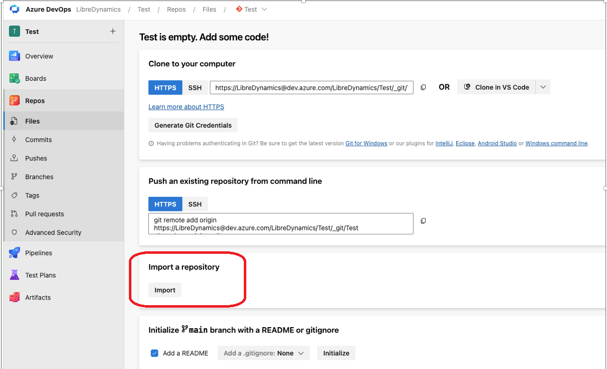
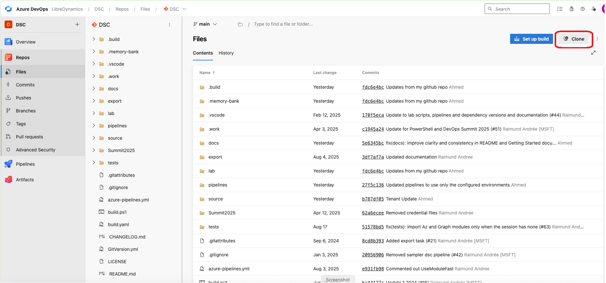
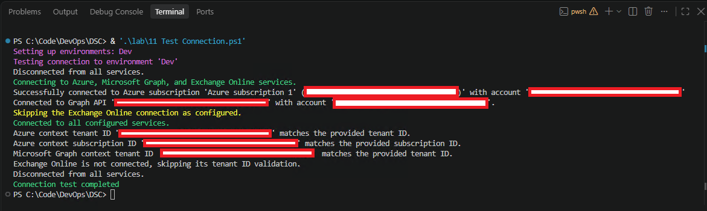
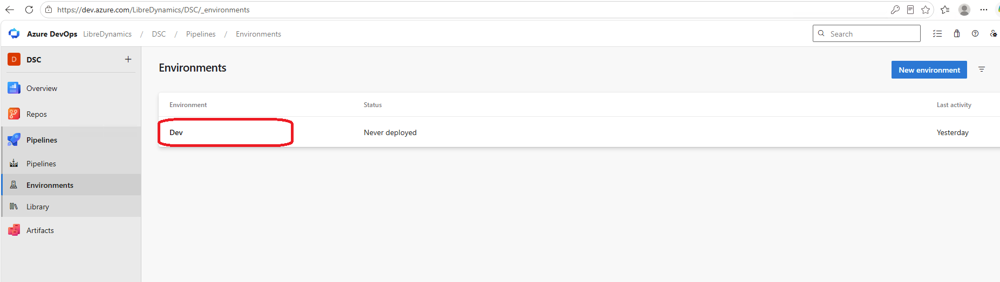
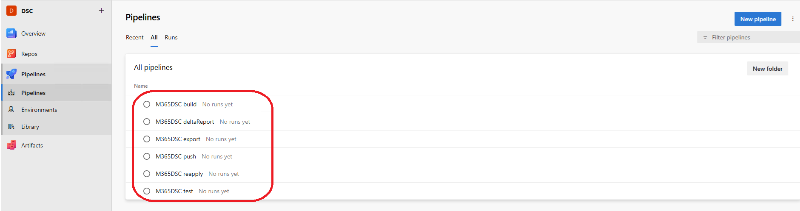

# The quick guide to the Microsoft365DscWorkshop

- [The quick guide to the Microsoft365DscWorkshop](#the-quick-guide-to-the-microsoft365dscworkshop)
  - [1. Getting started](#1-getting-started)
    - [1.0.1. Prerequisite: You must be a local administrator on the machine where you run the setup scripts](#101-prerequisite-you-must-be-a-local-administrator-on-the-machine-where-you-run-the-setup-scripts)
  - [1.1. Import the Project into Azure DevOps](#11-import-the-project-into-azure-devops)
  - [1.2. Cloning the Project](#12-cloning-the-project)
  - [1.3. Run the Lab Setup Scripts](#13-run-the-lab-setup-scripts)
    - [1.3.1. `00 Prep.ps1`](#131-00-prepps1)
    - [1.3.2. Test the Build and Download Dependencies](#132-test-the-build-and-download-dependencies)
  - [1.4. Set your Azure Tenant Details](#14-set-your-azure-tenant-details)
    - [1.4.1. Initialize the session (Init task)](#141-initialize-the-session-init-task)
    - [1.4.2. `10 Setup App Registrations.ps1`](#142-10-setup-app-registrationsps1)
    - [1.4.3. `11 Test Connection.ps1`](#143-11-test-connectionps1)
    - [1.4.4. `20 Configure AzDo Project.ps1`](#144-20-configure-azdo-projectps1)
    - [1.4.5. `30 Create Agent VMs.ps1`](#145-30-create-agent-vmsps1)
    - [1.4.6. `31 Agent Setup.ps1`](#146-31-agent-setupps1)
  - [1.5. Running the Pipeline](#15-running-the-pipeline)
  - [All done](#all-done)

## 1. Getting started

> :information_source: If you only want to export your tenant configuration with [Microsoft365DSC](https://microsoft365dsc.com/), see the [export guide](../export/readme.md).

### 1.0.1. Prerequisite: You must be a local administrator on the machine where you run the setup scripts

## 1.1. Import the Project into Azure DevOps

To use this project, you need to change some files, so first create a writable copy. Import this repository into a project hosted on Azure DevOps.

1. Create a new project in your Azure DevOps organization.
2. In the new project, open **Repos**.
3. Select **Import** to add the repository.
4. Enter `https://github.com/dsccommunity/Microsoft365DscWorkshop.git` as the clone URL and select **Import**. It may take a few seconds to copy the content.



This guide assumes that you have created an Azure DevOps project and imported this repository. Alternatively, you can fork it on GitHub, but some scripts will not work and you will need to perform the related tasks manually.

> **Warning:** You can run the project on any code management / automation platform of your choice, but for the standard setup to work, it is expected
> to host it on Azure DevOps.

## 1.2. Cloning the Project

Clone the project using the Source Control view in Visual Studio Code or the `git` command. Replace the placeholders below with your Azure DevOps repository URL and the local path where you want to clone it.

> :information_source: Select **Clone** in your Azure DevOps repository to get its HTTPS URL.

```powershell
git clone "https://dev.azure.com/ORGANIZATION/PROJECT/_git/REPOSITORY" "C:\path\to\local\repository"
```



## 1.3. Run the Lab Setup Scripts

After cloning the project to your development machine, open it in Visual Studio Code.

### 1.3.1. `00 Prep.ps1`

Run all commands in this guide from a PowerShell prompt opened at the repository root. All setup scripts other than the build script are in the [lab](../lab/) folder.

Run [00 Prep.ps1](../lab/00%20Prep.ps1):

```powershell
& '.\lab\00 Prep.ps1'
```

> :information_source: This script may kill the PowerShell session when setting local policies required for AutomatedLab. In this case, just try again.

The script performs the following steps:

- Installs the following modules to your machine:
  - [VSTeam](https://github.com/MethodsAndPractices/vsteam)
  - [AutomatedLab](https://automatedlab.org/en/latest/) and dependencies
- Sets the project name in [ProjectSettings.yml](../source/Global/ProjectSettings.yml) to the name of your Azure DevOps project. You should see the change in the Source Control view; it will be committed later.

---

### 1.3.2. Test the Build and Download Dependencies

Test the build locally by running the build script from a PowerShell prompt in the repository root:

```powershell
.\build.ps1 -UseModuleFast -ResolveDependency
```

> :information_source: [ModuleFast](https://github.com/JustinGrote/ModuleFast) may not download all required modules on the first try. If modules are missing or you see errors, close the PowerShell session and run the command again.

If ModuleFast repeatedly fails, for example with a gallery connection timeout, use PSResourceGet instead:

```powershell
.\build.ps1 -UsePSResourceGet -ResolveDependency
```

To resolve dependencies without running the build tasks, add `-Tasks noop`:

```powershell
.\build.ps1 -UsePSResourceGet -ResolveDependency -Tasks noop
```

The first build usually takes 15 to 20 minutes because it downloads the dependencies listed in [RequiredModules.psd1](../RequiredModules.psd1) and discovers the DSC resources in [Microsoft365DSC](https://microsoft365dsc.com/).

After the build finishes, verify that it created artifacts, such as MOF files in the [MOF](../output/MOF/) folder.

> :information_source: The [MOF](../output/MOF/) folder is generated by the build process and is not part of the repository. If it is missing after the build, check the console output for errors.

---

## 1.4. Set your Azure Tenant Details

This solution can configure multiple Azure tenants. Configure the tenants you want to manage in [Azure.yml](../source/Global/Azure.yml), which includes example Dev, Test, and Prod environments.

One Azure DevOps project can be used for multiple tenants. For this setup, each tenant needs its own Azure subscription to host that tenant's agent VM; the VM must be created in a subscription associated with the tenant it will manage.

- For each environment/tenant, update `AzTenantId`, `AzTenantName`, and `AzSubscriptionId`. The setup scripts you run next will populate the application IDs, secrets, and certificate thumbprints.

- Remove any environments you do not need from [Azure.yml](../source/Global/Azure.yml). For this guide, keep only the Dev environment.

- Also remove the build-agent configuration folders you do not need for this guide:
  - [Test](../source/BuildAgents/Test/)
  - [Prod](../source/BuildAgents/Prod/)

> **Warning:** Please don't forget to remove the environments you do not need.
>
> :information_source: When getting familiar with the project, it is recommended to start with one tenant. This reduces test run times and complexity.

For example, the file could look like this if you want to configure only one tenant:

```yml
Environments:
  Dev:
    AzTenantId: b246c1af-87ab-41d8-9812-83cd5ff534cb
    AzTenantName: MngEnvMCAP576786.onmicrosoft.com
    AzSubscriptionId: 9522bd96-d34f-4910-9667-0517ab5dc595
    Identities:
    - Name: M365DscSetupApplication
      ApplicationId: <AutoGeneratedLater>
      ApplicationSecret: <AutoGeneratedLater>
    - Name: M365DscLcmApplication
      ApplicationId: <AutoGeneratedLater>
      CertificateThumbprint: <AutoGeneratedLater>
    - Name: M365DscExportApplication
      ApplicationId: <AutoGeneratedLater>
      CertificateThumbprint: <AutoGeneratedLater>
```

---

### 1.4.1. Initialize the session (Init task)

> **Warning:** Start a new PowerShell session rather than reusing the old one. A module loaded during setup may prevent a newer version of an Azure PowerShell module from loading (a familiar issue known as [DLL Hell](https://en.wikipedia.org/wiki/DLL_hell)).
>
> And don't forget: Sometimes just retrying a failed task is the best and easiest solution.

After [00 Prep.ps1](../lab/00%20Prep.ps1) and [build.ps1](../build.ps1) finish, all required modules and dependencies should be available. In the new PowerShell session, run the build script again to initialize the shell:

```powershell
.\build.ps1 -Tasks init
```

---

### 1.4.2. `10 Setup App Registrations.ps1`

Run [10 Setup App Registrations.ps1](../lab/10%20Setup%20App%20Registrations.ps1). It creates the required applications in each tenant defined in [Azure.yml](../source/Global/Azure.yml) and grants them permissions to manage and export the tenant.

```powershell
& '.\lab\10 Setup App Registrations.ps1'
```

> **Warning:** The script connects to Microsoft Graph and Exchange Online, so you will see two authentication prompts for each tenant. One prompt opens in Microsoft Edge; the other opens in a separate window, which may be in the background. If the script appears to hang while waiting for the second prompt, check for another window.

> **Warning:** Git authentication with Azure DevOps at the end of the script requires JavaScript to be enabled in your browser. Add the sites when prompted.

- The `M365DscSetupApplication` app performs the initial environment setup. Although an Entra ID user could be used instead, authentication requirements may prevent the process from being automated.
- The `M365DscLcmApplication` app is used by the Azure DevOps build agent(s) to put your tenant into the desired state. A service principal is also created in Exchange Online for each app.
- The `M365DscExportApplication` app is used by the export pipeline. For details, see the [export guide](../export/readme.md).

> :information_source: To remove the app registrations if you no longer want to use the project, run [98 Cleanup App Registrations.ps1](../lab/98%20Cleanup%20App%20Registrations.ps1) from the repository root:
>
> ```powershell
> & '.\lab\98 Cleanup App Registrations.ps1'
> ```

Before doing any Exchange Online prep work, the script reads the `HasExchangeOnline` setting of the environment from the [Azure.yml](../source/Global/Azure.yml) file. Set it to `false` for a tenant without an Exchange Online license: such a tenant cannot create the Exchange service principals and cannot be added to the Exchange role groups, so these steps are skipped. The same setting removes the Exchange layers from the Datum hierarchy, so no `cEXO*` configuration is compiled and no Exchange component is exported for that tenant. If the setting claims Exchange Online but the tenant is not licensed for it, the script stops with an explicit error.

The `HasSharePointOnline` setting works similarly. Set it to `false` for a tenant that should not use SharePoint Online. This removes the SharePoint layers from the Datum hierarchy, so no `cSPO*` configuration is compiled or exported. If SharePoint Online is enabled but not provisioned, its admin URL (`https://<TenantName>-admin.sharepoint.com`) may not exist, and `cSPO*` resources can fail during enactment with `The current connection holds no SharePoint context`.

The app IDs are shown in the console. The secrets are also displayed there in plain text and are written encrypted to [Azure.yml](../source/Global/Azure.yml). The script commits and pushes the updated file to the repository.

> **Warning:** The password used to encrypt the app secrets is taken from [Datum.yml](../source/Datum.yml). This is not a secure solution; it is intended only for proof-of-concept use. For production tenants, replace the passphrase with a certificate.

---

### 1.4.3. `11 Test Connection.ps1`

The previous step created applications and stored their authentication credentials in [Azure.yml](../source/Global/Azure.yml). Now test whether authentication with the new applications works.

Run [11 Test Connection.ps1](../lab/11%20Test%20Connection.ps1):

```powershell
& '.\lab\11 Test Connection.ps1'
```

The last line of its output should be `Connection test completed`.


---

### 1.4.4. `20 Configure AzDo Project.ps1`

This script configures the Azure DevOps project and stores its settings in [ProjectSettings.yml](../source/Global/ProjectSettings.yml). It prompts for any required values that are still placeholders in the file.

```yml
OrganizationName: <OrganizationName>
PersonalAccessToken: <PersonalAccessToken>
ProjectName: <ProjectName>
AgentPoolName: <AgentPoolName>
```

Run [20 Configure AzDo Project.ps1](../lab/20%20Configure%20AzDo%20Project.ps1). It prompts for each value that is still a placeholder in [ProjectSettings.yml](../source/Global/ProjectSettings.yml). Press Enter to accept the suggested project and agent-pool names.

1. Create a personal access token (PAT) for your Azure DevOps organization with the permissions required to manage the project. Copy the PAT to the clipboard.

2. Run [20 Configure AzDo Project.ps1](../lab/20%20Configure%20AzDo%20Project.ps1) and provide the requested information.

```powershell
& '.\lab\20 Configure AzDo Project.ps1'
```

The script:

- Prompts for the Azure DevOps organization name, project name, and PAT.
- Updates [ProjectSettings.yml](../source/Global/ProjectSettings.yml) with the information you provide.
- Creates the configured agent pool (named `DSC` by default).
- Disables non-required project features.
- Creates Azure DevOps environments based on [Azure.yml](../source/Global/Azure.yml).
- Creates the `M365DSC build`, `M365DSC deltaReport`, `M365DSC export`, `M365DSC push`, `M365DSC reapply`, and `M365DSC test` pipelines.

Inspect the Azure DevOps project. You should now see the environments, agent pool, and pipelines.




---


### 1.4.5. `30 Create Agent VMs.ps1`

The script [30 Create Agent VMs.ps1](../lab/30%20Create%20Agent%20VMs.ps1) creates one VM for each configured environment in that tenant's Azure subscription. It assigns a managed identity to each VM and grants that identity the permissions Microsoft365DSC needs to manage the tenant.

The next step connects each VM to Azure DevOps as a build agent. The agents build the DSC configuration and apply it to their respective tenants.

The VMs are created using [AutomatedLab](https://automatedlab.org/en/latest/), which handles the setup details. The script typically takes 20 to 30 minutes to run. The relevant settings in `ProjectSettings.yml` are:

```yml
BuildAgents:
  UserName: worker
  Password: <Password>
```

Run [30 Create Agent VMs.ps1](../lab/30%20Create%20Agent%20VMs.ps1):

```powershell
& '.\lab\30 Create Agent VMs.ps1'
```

By default, the script tells AutomatedLab to use its stable Azure resource
provider API versions. To have AutomatedLab select the latest API versions
reported by the Azure provider in the target region instead, pass
`-UseLatestAzureProviderApi`:

```powershell
& '.\lab\30 Create Agent VMs.ps1' -UseLatestAzureProviderApi
```

The latest API version is not necessarily available in every region. In
AutomatedLab 5.61.0, the stable API version used for managed disks is
`2022-01-01`, while the latest-provider mode can select `2026-10-02`. Both
versions have been rejected for managed disks in South Africa North. The
troubleshooting section below describes the error; in this case, simply
switching this parameter on or off does not resolve it.

You will be prompted to choose a password for the build-agent VMs. You can use the default password shown in the prompt or enter a different one.

> **Warning:** Please make sure the password meets the Windows standard complexity.

#### Troubleshooting: unsupported managed disk API version (older script versions)

Older versions of `30 Create Agent VMs.ps1` created an additional 250-GB managed
data disk for each agent. In some Azure regions, deployment of that disk failed
because the API version selected by AutomatedLab was not available there. In
South Africa North, both API-version selection modes in AutomatedLab 5.61.0
have produced this error (with the applicable API version varying by mode):

```text
No registered resource provider found for location 'southafricanorth' and API version '2026-10-02' for type 'disks'. The supported api-versions are '2016-04-30-preview, 2017-03-30, 2018-04-01, 2018-06-01, 2018-09-30, 2019-03-01, 2019-07-01, 2019-11-01, 2020-05-01, 2020-06-30, 2020-09-30, 2020-12-01, 2021-04-01, 2021-08-01, 2021-12-01, 2022-03-02, 2022-07-02, 2023-01-02, 2023-04-02, 2023-10-02, 2024-03-02, 2025-01-02, 2026-03-02'.
Disk LcmDSCDevData1 is not found. (Code:NotFound)
```

The current script no longer creates this additional data disk, so update to
the current version of the script and rerun VM creation. The VM will use its
operating-system disk only; it will not have the separate 250-GB data disk.
Switching `-UseLatestAzureProviderApi` on or off is not a workaround for this
error in AutomatedLab 5.61.0: the stable version `2022-01-01` and the latest
version `2026-10-02` have both been rejected.

---

### 1.4.6. `31 Agent Setup.ps1`

The script [31 Agent Setup.ps1](../lab/31%20Agent%20Setup.ps1) connects to each build-agent VM created in the previous step and installs:

- PowerShell 7
- Git
- Visual Studio Code
- Azure DevOps Build Agent
- The latest PowerShellGet module and NuGet package provider

Run the script:

```powershell
& '.\lab\31 Agent Setup.ps1'
```

The script then connects each agent to the specified Azure DevOps organization and adds it to the configured agent pool. It also creates a self-signed client-authentication certificate on the agent and writes the certificate thumbprint to [Azure.yml](../source/Global/Azure.yml).

Check the configured Azure DevOps agent pool to confirm that the new agents appear. Each agent should have a `BuildEnvironment` capability set to its corresponding environment.

---

## 1.5. Running the Pipeline

The [20 Configure AzDo Project.ps1](../lab/20%20Configure%20AzDo%20Project.ps1) script creates these six runnable pipelines:

- `M365DSC build`
- `M365DSC deltaReport`
- `M365DSC export`
- `M365DSC push`
- `M365DSC reapply`
- `M365DSC test`

The [pipelines folder](../pipelines/) also contains YAML templates used by these pipelines. Template files such as `buildTemplate.yml` and `testDscTemplate.yml` are building blocks, not additional pipelines to run directly.

The `M365DSC push` pipeline runs for changes to the `main` branch, except changes limited to `CHANGELOG.md`, and for tags that start with `v` and do not contain a hyphen. It builds the DSC artifacts, applies the configuration to the configured tenants, and validates the result.

The `M365DSC push` pipeline may have started automatically. If no run appears, start it manually from the Pipelines page in Azure DevOps, then open the run.

- Open the Pipelines page in your Azure DevOps project.
- If the run is waiting for permission to access a resource, Azure DevOps displays a message such as: `This pipeline needs permission to access a resource before this run can continue to Build of environment Dev`.

Select **View** next to the permission message, then select **Permit** in the **Waiting for review** dialog.

After a few seconds, a build agent should pick up the job.

> To see what the build agent is doing, open the `Build of environment Dev` stage. In [Test the Build and Download Dependencies](#132-test-the-build-and-download-dependencies), you ran the build script locally and created artifacts such as RSOP and MOF files. The agent performs the same process, so the output should look familiar.

After the `Build of environment Dev` stage finishes, open the `Deployment in Dev` stage. The first time the pipeline deploys to the Dev environment, Azure DevOps may ask you to grant it permission.

If a permission message appears, select **View** next to it and then select **Permit**, as you did in the previous step.

The `Deployment in Dev` stage applies the desired state defined in the YAML files to the tenant. Microsoft365DSC changes settings that do not match the desired state.

The final stage is `Validating DSC Configuration of environment Dev`. It compares the tenant's current state with the desired state again and reports any differences. If this stage succeeds, the configuration matches the desired state.

## All done

You have completed the getting started guide. You now have an Azure tenant under source control. To follow DevOps best practices, all changes to your Azure tenant should be made through the pipelines you have set up. This ensures that all changes are tracked, repeatable, and can be rolled back if necessary.

From now on, you should:

1. **Make Changes in Source Control**: Any configuration changes should be made in the YAML files within your repository. This ensures that all changes are versioned and can be reviewed through pull requests.
2. **Run Pipelines for Deployment**: Use the Azure DevOps pipelines to apply changes to your Azure tenant. This ensures that the desired state defined in your YAML files is enforced.
3. **Monitor and Validate**: Regularly monitor the pipeline runs and validate that the deployments are successful. The validation stage in your pipeline will help ensure that the current state matches the desired state.
4. **Iterate and Improve**: Continuously improve your configurations and pipelines. As you become more familiar with Microsoft365DSC and Azure DevOps, you can add more automation and checks to your processes.

By following these practices, you will maintain a consistent and reliable configuration for your Azure tenant, leveraging the power of DevOps and infrastructure as code.
